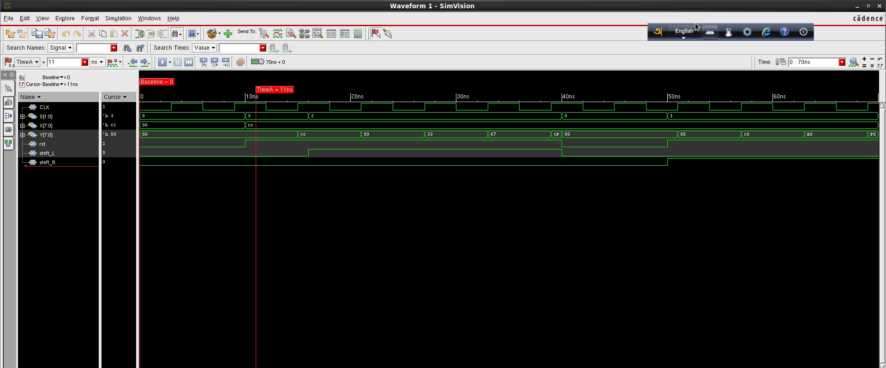

# 8-Bit Ripple Carry Adder

## Project Overview

This project focuses on the RTL design, functional simulation, and logic synthesis of an **8-bit Ripple Carry Adder (RCA)** using Verilog HDL and Cadence EDA tools.

A Ripple Carry Adder is a combinational digital circuit that performs binary addition of two 8-bit operands. It consists of cascaded full-adder stages, where the carry output of each stage propagates to the next stage.

## Project Objectives

- Design an 8-bit Ripple Carry Adder using Verilog HDL.
- Implement the design using cascaded full-adder stages.
- Verify functionality through simulation.
- Analyze sum and carry propagation using waveform results.
- Perform logic synthesis using Cadence tools.

## Design Specifications

**Inputs:**
- A[7:0] — First 8-bit operand
- B[7:0] — Second 8-bit operand
- Cin — Carry input

**Outputs:**
- Sum[7:0] — 8-bit addition result
- Cout — Final carry output

## Tools and Technologies

- Verilog HDL
- Cadence EDA tools
- RTL Design
- Functional Simulation
- Logic Synthesis

## Repository Structure

| Directory / File | Description |
|---|---|
| `constraints/` | Synthesis constraints |
| `RTL/` | Verilog HDL design files |
| `synthesis/` | Synthesis scripts and results |
| `waveforms/` | Simulation waveform screenshots |
| `lib/` | Technology library files |
| `Project Report.pdf` | Complete project report |

## Simulation Results

The following waveforms demonstrate the functional verification of the 8-bit Ripple Carry Adder.

### Waveform 1

### Waveform 2

### Waveform 3

## Synthesis Results

The design was synthesized using Cadence tools as part of the digital hardware implementation process.

## Project Documentation

[View the Complete Project Report (PDF)](Project%20Report.pdf)

## Project Type

Academic Digital Design and VLSI Project.

**Author:** Mashruk Rafin  
**Department:** Electrical and Electronic Engineering (EEE)  
**Institution:** United International University (UIU)
