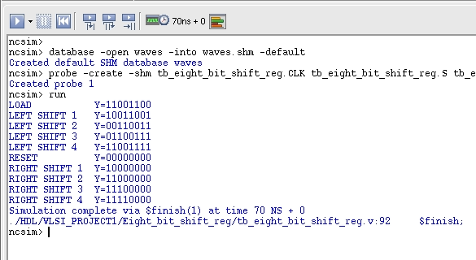
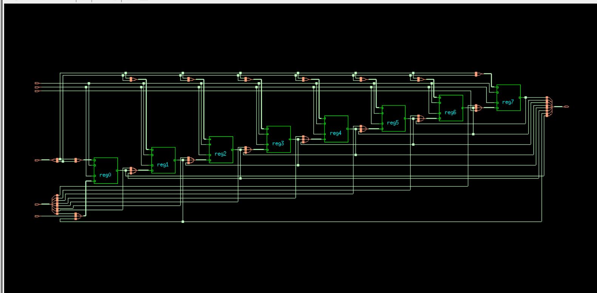

# 8-Bit Universal Shift Register

## Project Overview

This project focuses on the RTL design, functional simulation, and logic synthesis of an **8-bit Universal Shift Register** using Verilog HDL and Cadence Genus.

The design supports four operating modes: hold, shift right, shift left, and parallel load. It is implemented using structural Verilog.

## Project Objectives

- Design an 8-bit Universal Shift Register using Verilog HDL.
- Implement four operating modes.
- Verify functionality through RTL simulation.
- Perform logic synthesis using Cadence Genus.

## Design Specifications

**Inputs:**
- `D[7:0]` — 8-bit parallel data input
- `S[1:0]` — Mode selection
- `CLK` — Clock input
- `RESET` — Active-low reset

**Output:**
- `Q[7:0]` — 8-bit register output

**Operating Modes:**

| S[1:0] | Operation |
|:---:|---|
| 00 | Hold |
| 01 | Shift Right |
| 10 | Shift Left |
| 11 | Parallel Load |

## Tools and Technologies

- Verilog HDL
- Cadence Genus 16.13
- RTL Design
- Functional Simulation
- Logic Synthesis

## Repository Structure

| Directory / File | Description |
|---|---|
| `constraints/` | Synthesis constraints |
| `RTL/` | Structural Verilog design files |
| `synthesis/` | Synthesis scripts and results |
| `waveforms/` | RTL simulation waveform screenshots |
| `lib/` | Technology library files |
| `Project Report.pdf` | Project documentation |

## Simulation Results

RTL simulation was performed to verify the four operating modes: hold, shift right, shift left, and parallel load.
### Waveform 1

### Display Output

## Synthesis Results

The design was synthesized using Cadence tools as part of the digital hardware implementation process.
### Synthesized Block

## Project Documentation

[View the Complete Project Report (PDF)](Project%20Report.pdf)

## Project Type

Academic Digital Design and VLSI Project.

**Author:** Mashruk Rafin  
**Department:** Electrical and Electronic Engineering (EEE)  
**Institution:** United International University (UIU)
